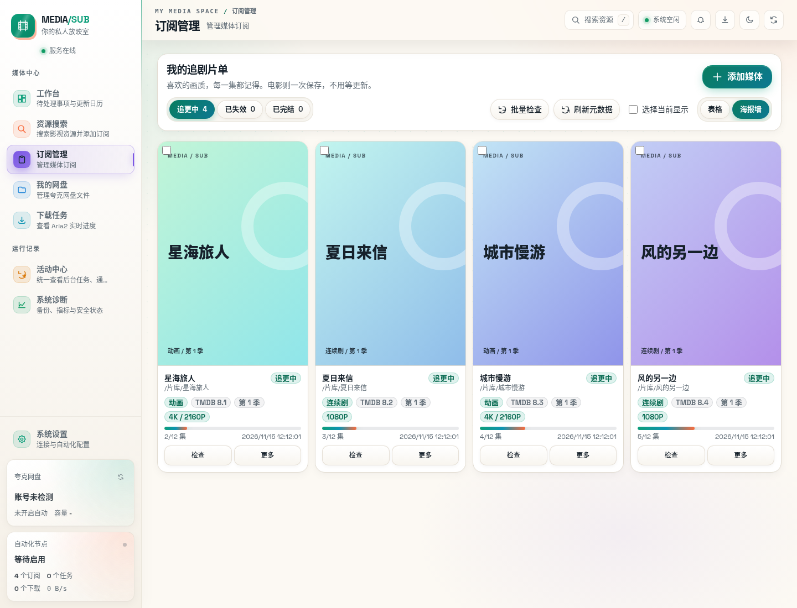

# My Media Sub

My Media Sub 为家庭自托管用户提供电影一次保存和剧集自动追更，从夸克分享选择画质，按规则转存、重命名并按需下载。

[](https://github.com/hellomrli/my-media-sub/actions/workflows/ci.yml)
[](https://github.com/hellomrli/my-media-sub/releases)
[](LICENSE)

[快速开始](#快速开始) · [文档入口](docs/index.md) · [下载发布版](https://github.com/hellomrli/my-media-sub/releases)



*实际 WebUI 的本地演示，使用测试数据。*

## 快速开始

准备 Docker、Compose v2、curl 和 OpenSSL。在一个新的安装目录运行：

```bash
set -eu
mkdir my-media-sub
cd my-media-sub
curl -fsSLo compose.yaml https://raw.githubusercontent.com/hellomrli/my-media-sub/main/docker-compose.yml
(umask 077; printf 'SERVER_PASSWORD=%s\n' "$(openssl rand -hex 24)" > .env)
docker compose up -d
```

在部署机器打开 **http://127.0.0.1:56001**，用 `admin` 和 `.env` 中刚生成的密码登录。密码文件保持私有，不要在已有部署中重复生成。

```bash
curl --fail http://127.0.0.1:56001/health
```

启动完成后返回含 `"status":"ok"` 和当前版本的 JSON；首次拉取镜像时可用 `docker compose logs --tail=50` 查看状态。

> [!IMPORTANT]
> Compose 默认只向本机发布端口。远程 NAS 或服务器通过 [HTTPS 反代或 SSH 转发](docs/deployment.md#连接远程-nas-或服务器) 接入；保留 `data/` 和 `runtime/` 两个持久化目录。

不使用容器时，按 [Linux x86_64 发布包安装步骤](docs/deployment.md#使用-linux-x86_64-发布包) 下载、校验和启动；其他平台需自行构建。

## 完成第一次保存或追更

1. 在系统设置填写夸克 Cookie，测试连接。
2. 添加媒体并粘贴分享链接：电影选择画质与一个正片；剧集选择季度、画质和目标目录。
3. 电影执行“下载保存”；剧集保存订阅后执行一次“立即检查”。
4. 在任务、活动记录和自己的夸克网盘查看结果。

搜索、TMDB 和下载器均可按需接入。已配置 Aria2 时可同步下载，未配置时仍可保存网盘。逐步操作与首次排错见 [首次使用](docs/usage.md)。

## 使用能力与边界

- **电影一次保存**：按画质选择具体正片，不创建持续订阅；同画质的不同剪辑版本也可单独选择。
- **剧集固定画质追更**：支持单季、连续多季和跳季，识别缺集与重复版本，按规则转存和重命名。固定画质缺失时等待，不回退到其他版本。
- **换源与后台任务**：对比候选并保留进度，提供换源历史与回滚；自动换源默认关闭。持久化队列记录进度、失败、取消与重启恢复。
- **家庭媒体库集成**：可选 Aria2 下载、Jellyfin/Emby/Plex 刷新和多渠道通知。
- **手机入口**：响应式 WebUI、媒体日历、PWA 和受控 Telegram Bot。

当前面向单实例、单管理员和夸克网盘。画质通过文件名与目录标记识别，不读取视频码流；规则式剧名回退不调用大模型。匹配失败不把试探词写成正式订阅名，网络或凭据错误直接报告。

Rust / Axum / Tokio 后端与 Alpine.js WebUI 使用版本化 JSON 保存业务数据，不需要外部数据库。

## 按任务查文档

| 任务 | 文档 |
|---|---|
| 安装、远程访问和启动排错 | [部署指南](docs/deployment.md) |
| 选择画质、正片和剧集季度 | [首次使用](docs/usage.md) · [电影保存与画质](docs/media-save-quality.md) |
| 配置网盘、下载器、通知与手机入口 | [集成与设置](docs/integrations.md) · [Telegram](docs/telegram-bot.md) · [PWA](docs/pwa.md) |
| 匹配剧名、查看排期和调整换源 | [剧名匹配](docs/title-matching.md) · [媒体日历](docs/media-calendar.md) · [资源质量](docs/source-quality.md) |
| 备份、升级和恢复 | [数据维护](docs/data-maintenance.md) · [Docker 在线更新](docs/docker-online-update.md) |
| API 自动化和参与开发 | [自动化 API](docs/automation-api.md) · [本地开发](docs/development.md) · [架构](docs/architecture.md) |

[完整文档索引](docs/index.md) 收录升级指南、存储规划、审计和历史评审。[路线图](docs/roadmap.md) 是持久化计划入口。

## 接入 API 或参与开发

登录后访问 `/api-docs.html` 查看交互式 API 文档；[`static/openapi.json`](static/openapi.json) 覆盖 94 个路径、106 个操作。自动化使用最小权限 Bearer Token；设置、备份恢复和在线更新等管理操作只接受管理员凭据。[API 契约](docs/api-contract.md) 说明响应、错误码与 SSE。

开发和发布使用 `rust-toolchain.toml` 固定的 Rust 1.99.1；`Cargo.toml` 的 1.89 是最低源码兼容版本（MSRV）。前端无需打包器，`static/index.html` 由模板生成，编辑与验证步骤见 [开发指南](docs/development.md)。

反馈请提交 [Issue](https://github.com/hellomrli/my-media-sub/issues)，附上版本、部署方式、复现步骤和脱敏日志。

## 版本说明

### 2.8.3

本版修复手机上更新日历周视图的显示，并整理日历样式，可直接复用 v2.8.2 的数据与配置。

- **手机周视图不再裁掉剧名**：一条排期占满一行，过长的剧名显示省略号；此前条目比可用宽度更宽，剧名被卡片边缘直接裁掉，视图右缘也伸出卡片。
- **日历样式合并**：分散的日历规则合并为一节并删除不再使用的部分；平板和桌面宽度下的显示不变，由真实浏览器逐元素比较计算样式确认。
- **新增浏览器回归**：检查手机周视图不伸出卡片、长剧名正确省略。

### 2.8.2

本版完善手机操作、弹窗键盘导航和状态反馈，可直接复用 v2.8.1 的数据与配置。

- **手机界面更紧凑**：订阅批量操作收进“更多”，设置概览可折叠，当前导航项在切页、返回和缩放后保持可见。
- **下载操作恢复**：修复空闲任务按钮被错误禁用，暂停、继续、重试和删除按任务状态正常启用；当前下载分类保持可见。
- **状态反馈更准确**：工作台按类别显示失效订阅、失败任务和未读通知，并直达相应筛选；连接状态来自实际请求，断连时可重试；刷新同时更新日历。
- **键盘操作与可读性**：弹窗显示后自动聚焦，Tab 循环排除隐藏控件；改善浅深色状态文字和按钮内边距，修复补集提示、运行中编号及未启用流水线的淡化文字。
- **带数据的浏览器回归**：覆盖多季剧集筛选、六种流水线状态、四类下载任务和订阅详情跳转，增加这些状态的实测文字对比度检查。

- 当前版本：[v2.8.3 升级指南](docs/upgrade-v2.8.3.md)
- 全部改动：[CHANGELOG](CHANGELOG.md) · [历史版本摘要](docs/version-history.md) · [Releases](https://github.com/hellomrli/my-media-sub/releases)

## 许可证

[MIT](LICENSE)。
