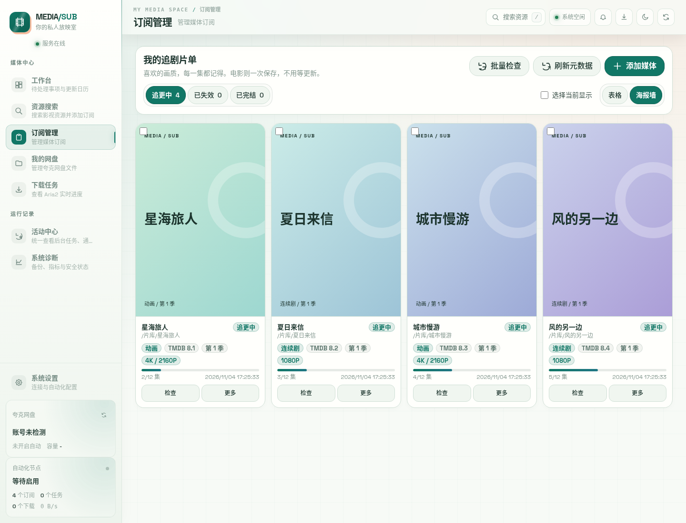

# My Media Sub

为家庭自托管用户提供电影保存与剧集自动追更：从分享链接选择画质，电影一次保存、按需下载，剧集定时检查、转存与重命名。

[](https://github.com/hellomrli/my-media-sub/actions/workflows/ci.yml)
[](https://github.com/hellomrli/my-media-sub/releases)
[](LICENSE)

[快速开始](#快速开始) · [剧名匹配](#剧名查不到时会怎样) · [使用文档](docs/usage.md) · [下载发布版](https://github.com/hellomrli/my-media-sub/releases)



*实际 WebUI 的本地演示，使用测试数据，不含真实账号或网盘资源。*

## 快速开始

推荐 Docker Compose。需要 Docker、Compose v2，以及终端中的 `curl` 和 `openssl`。以下命令在一个**新的安装目录**中执行，为管理员生成随机密码：

```bash
set -eu
mkdir my-media-sub
cd my-media-sub
curl -fsSLo compose.yaml https://raw.githubusercontent.com/hellomrli/my-media-sub/main/docker-compose.yml
(umask 077; printf 'SERVER_PASSWORD=%s\n' "$(openssl rand -hex 24)" > .env)
docker compose up -d
```

在部署机器上打开 **http://127.0.0.1:56001**，用户名为 `admin`，密码保存在刚生成的 `.env` 中。可在本机用 `cat .env` 查看，勿上传或分享该文件。

```bash
curl --fail http://127.0.0.1:56001/health
```

启动完成后返回含 `"status":"ok"` 和当前版本的 JSON。首次拉取镜像期间可用 `docker compose logs --tail=50` 查看启动状态。

> [!IMPORTANT]
> Compose 默认只监听本机，部署在 NAS 或远程服务器上时，不能直接用服务器 IP 访问。请通过 [HTTPS 反向代理](docs/https-reverse-proxy.md) 或 SSH 端口转发接入；不要把管理端口直接暴露到公网。

不使用容器？[部署与使用参考](docs/usage.md) 提供 Linux x86_64 发布二进制的下载、校验与启动步骤；其他平台需自行构建。Compose 的两个持久化目录分别是 `data/`（业务数据）和 `runtime/`（可在线更新的程序与 WebUI），升级时都要保留。

## 订阅第一部剧

1. 登录系统设置，填写夸克 Cookie；这是探测分享和执行转存的必要凭据。
2. 添加媒体，粘贴分享链接，确认识别后的剧名、季度与画质。支持单季、连续多季和 `1,3` 这样的跳季选择。
3. 选择目标目录和是否自动转存，保存后执行一次“立即检查”。
4. 在任务和活动记录中查看结果；成功转存的文件出现在自己的夸克网盘中。

## 保存电影与选择画质

- **电影不追更**：选择“电影”后进入“选择片源 → 下载保存”，不创建订阅。先选 1080P / 4K，再选择具体正片；同画质的不同剪辑版本也可以单独选择。
- **按需下载**：已配置 Aria2 时默认同时下载到本地，也可只保存到网盘；未配置下载器时仍可保存。只转存所选正片，不会整包保存其他画质、预告和花絮。
- **剧集固定画质**：选择的画质会持久化到订阅规则，后续检查、转存及换源都会遵守。当前没有该画质时等待更新，不会偷偷回退到其他版本；也可以保留原有的自动择优策略。
- **兼容分文件夹的资源**：同时识别文件名和上层目录中的画质标记；未标注的资源明确显示为未知，不猜测实际分辨率。

电影保存进度在后台任务、网盘与下载管理中查看。旧电影订阅保留数据和手动操作，但不再参与定时追更。修改剧集画质只影响后续更新，不清空已有进度。详细流程与 API 见 [电影保存与画质选择](docs/media-save-quality.md)。

不需要先配置搜索、刮削或下载器才能添加分享链接。按需启用这些集成：

| 想做什么 | 需要配置什么 |
|---|---|
| 聚合搜索资源 | PanSou 服务地址 |
| 匹配标准剧名、海报、年份与集数 | TMDB API Key |
| 将转存后的文件下载到本地 | Aria2 RPC、密钥与下载目录 |
| 收到追更结果 | 至少一个通知渠道 |
| 用聊天命令管理订阅 | Telegram Bot Token、用户白名单与授权 |

## 自动完成哪些工作

- **持续追更**：按订阅间隔检查分享，识别季集、缺集与重复版本，按规则转存和重命名。
- **管理多季资源**：探测分享内季度，预览重命名结果，并按文件实际季号分目录。
- **处理失效分享**：搜索并对比换源候选，保留进度，提供历史与回滚；自动换源默认关闭。
- **跟踪后台任务**：持久化队列记录执行进度、失败和取消，支持安全重试与重启恢复。
- **连接家庭媒体库**：可选 Aria2 下载、Jellyfin/Emby/Plex 刷新，以及 Telegram、Bark、Gotify、浏览器推送等通知。
- **在手机上使用**：响应式 WebUI、更新日历、PWA 安装和 Telegram Bot，复用同一套订阅数据。

项目采用 Rust / Axum / Tokio 后端与 Alpine.js WebUI，数据保存在版本化 JSON 中，不需要外部数据库。当前只面向**单实例、单管理员、夸克网盘**，不是多用户或多网盘平台。

## 剧名查不到时会怎样

“智能识别剧名”先沿用现有清洗规则，去掉字幕组、画质和季集标记。如果 TMDB 返回空结果，再尝试有依据的标题变体，而不是停在第一次失败：

| 原搜索词或分享标题 | 可尝试的后续搜索词 |
|---|---|
| `凡人修仙传之星海飞驰篇` | `凡人修仙传` |
| `未知译名 / Known English Title` | `Known English Title` |
| `国漫：凡人修仙传` | `凡人修仙传` |
| `庆 余 年` | `庆余年` |

最多尝试 6 个去重后的剧名，标题查询阶段总预算 30 秒；命中后停止，表单显示尝试过的名称。只有匹配成功才应用 TMDB 返回的标准标题，失败不会把试探词写成订阅名。年份提示和手工季度选择继续保留。

这是规则式回退，不调用大模型、不猜测任意译名。网络故障、限流或 Key 错误会直接报错，不继续改名重试。后台元数据刮削复用同一逻辑。边界与 API 字段见 [剧名匹配说明](docs/title-matching.md)。

## 保存数据与升级

- 保留 `data/` 和 `runtime/`。同一个数据目录只允许一个实例运行。
- 升级前创建并核对备份。备份包含 Cookie、Token 等凭据，应限制访问并妥善保存。
- Store 损坏后默认停止启动并保留隔离副本，不会静默用空数据覆盖原内容。
- 在线更新同时切换程序和 WebUI；手工更新也必须替换整套静态资源。恢复备份在下一次重启时应用。

详细操作见 [数据、备份与升级](docs/usage.md#数据备份与升级)、[Docker 在线更新](docs/docker-online-update.md) 和 [依赖审计](docs/security-audit.md)。环境变量见 [`.env.example`](.env.example)；Compose 会读取 `.env`，独立二进制和 `cargo run` 需要显式导出环境变量。

## 接入 API 或参与开发

登录后访问 `/api-docs.html` 查看交互式 API 文档；[`static/openapi.json`](static/openapi.json) 覆盖 94 个路径、106 个操作。自动化脚本可使用最小权限 Bearer Token，不必持有管理员密码；令牌不开放设置、备份恢复或在线更新等管理操作。

- [API 契约与错误码](docs/api-contract.md) · [自动化 API](docs/automation-api.md)
- [从源码构建与验证](docs/development.md) · [分层架构](docs/architecture.md)

开发、CI、发布二进制和 Docker 构建均使用 **Rust 1.99.1**，由 `rust-toolchain.toml` 固定。`Cargo.toml` 中的 **1.89 只是最低源码兼容版本（MSRV）**，不是发布时使用的编译器。前端无需打包器，`static/index.html` 由模板生成，不要直接修改。

## 按任务查文档

| 任务 | 文档 |
|---|---|
| 安装、配置、排查首次运行 | [部署与使用参考](docs/usage.md) |
| 调整剧名匹配、理解重试边界 | [剧名匹配](docs/title-matching.md) |
| 查看追更日期与执行过程 | [媒体日历](docs/media-calendar.md) · [自动化事件](docs/automation-events.md) |
| 配置通知和手机入口 | [Telegram Bot](docs/telegram-bot.md) · [PWA](docs/pwa.md) |
| 调整资源评分和换源 | [资源质量与换源](docs/source-quality.md) |
| 保存电影、选择剧集画质 | [电影保存与画质选择](docs/media-save-quality.md) |
| 配置反代、更新与存储 | [HTTPS](docs/https-reverse-proxy.md) · [Docker 在线更新](docs/docker-online-update.md) · [存储扩展](docs/storage-scaling.md) |
| 了解项目计划与评审结果 | [路线图](docs/roadmap.md) · [代码评审](docs/code-review-2026-09-21.md) |
| 维护与发布 | [依赖审计](docs/security-audit.md) · [发布流程](docs/release-workflow.md) |

问题和建议请提交 [Issue](https://github.com/hellomrli/my-media-sub/issues)，附上版本、部署方式、复现步骤和脱敏日志。不要公开 Cookie、Token、密码或完整备份。

## 版本说明

### 2.8.0

- **更轻快的界面**：青绿与杏橙配色、自托管字体、海报墙和响应式弹窗；保留已有深色主题与表格偏好。
- **电影一次保存**：选择“电影”后直接进入下载保存，不再创建追更订阅；按画质选择具体正片，可只保存网盘或同时提交 Aria2 下载。
- **剧集自选画质**：嗅探文件名与画质文件夹中的 1080P / 4K 等版本；固定画质贯穿检查、转存、重命名和换源，不静默降级。旧订阅默认沿用自动择优。
- **保存更可核验**：执行时重新核对所选文件，下载前解析自己网盘的文件 ID；下载失败保留已保存结果，避免重新转存。

- 当前版本：[v2.8.0 升级指南](docs/upgrade-v2.8.0.md)
- 使用说明：[电影保存与画质选择](docs/media-save-quality.md)
- 全部改动：[CHANGELOG](CHANGELOG.md) · [历史版本摘要](docs/version-history.md) · [GitHub Releases](https://github.com/hellomrli/my-media-sub/releases)

## 许可证

[MIT](LICENSE)。
